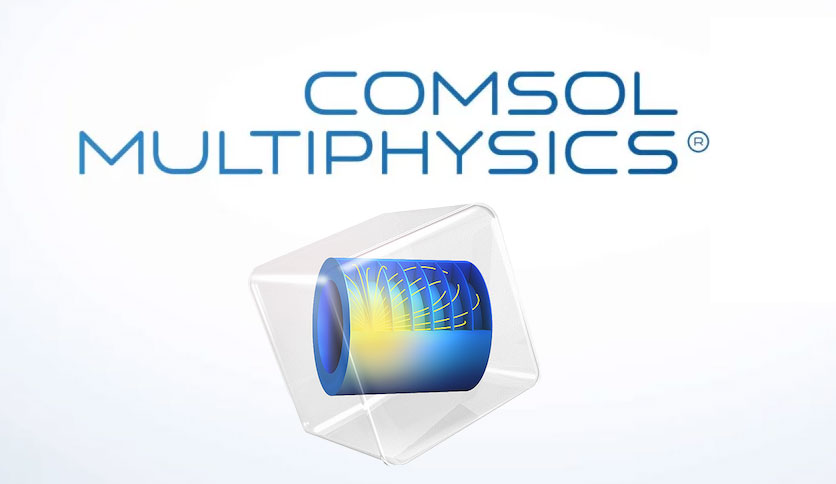
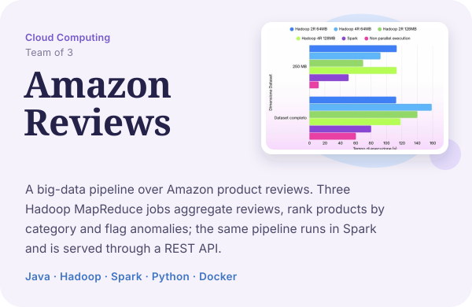

<!-- Animated images live in /assets -->

## About me

I'm a Master's student in **Artificial Intelligence & Data Engineering** at the **University of Pisa**. I graduated in **Biomedical Engineering** in 2025 with a thesis on recognising human emotions from **EEG signals**, combining signal processing and machine learning.

Today my focus is AI and data, but I also care about the visual side of my projects: I like building software that works well, looks good and is easy to use. I'm curious by nature, always trying new tools and looking for the next thing to learn.

- **Signals & machine learning**: EEG processing and emotion recognition, with MATLAB, Python and COMSOL for analysis and modelling
- **Data engineering & big data**: distributed processing with Hadoop and Spark, modelling across relational, document and graph stores (MySQL, MongoDB, Neo4j)
- **Software**: Java applications end to end, from Spring back ends to JavaFX interfaces, containerised with Docker
- **Design**: Figma and Canva, so that what I build is also clear and pleasant to use

## Path

## Stack

<b>See the full toolbox</b>

 

| | |
|---|---|
| **Languages** |       |
| **Data & big data** |      |
| **Frameworks & tools** |           |
| **Engineering & design** |     |

## Featured projects

  
  

  
  

