<!-- Animated images live in /assets -->

<a href="https://www.linkedin.com/in/ericaginevri">
  
</a>

## About me

I'm a Master's student in **Artificial Intelligence & Data Engineering** at the **University of Pisa**. I graduated in **Biomedical Engineering** in 2025 with a thesis on recognising human emotions from **EEG signals**, combining signal processing and machine learning.

Today my focus is AI and data, but I also care about the visual side of my projects: I like building software that works well, looks good and is easy to use. I'm curious by nature, always trying new tools and looking for the next thing to learn.

- **Signals & machine learning**: EEG processing and emotion recognition, with MATLAB and Python, plus COMSOL for modelling
- **Data engineering & big data**: distributed processing with Hadoop and Spark, modelling across relational, document and graph stores (MySQL, MongoDB, Neo4j)
- **Software**: Java applications end to end, from Spring back ends to JavaFX interfaces, containerised with Docker
- **Design**: Figma and Canva, so that what I build is also clear and pleasant to use

---

---


<b>See the full toolbox</b>

 

| | |
|---|---|
| **Languages** |        |
| **Data & ML** |            |
| **Frameworks & tools** |          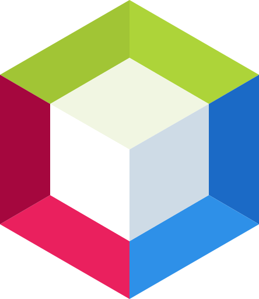   |
| **Engineering & design** | 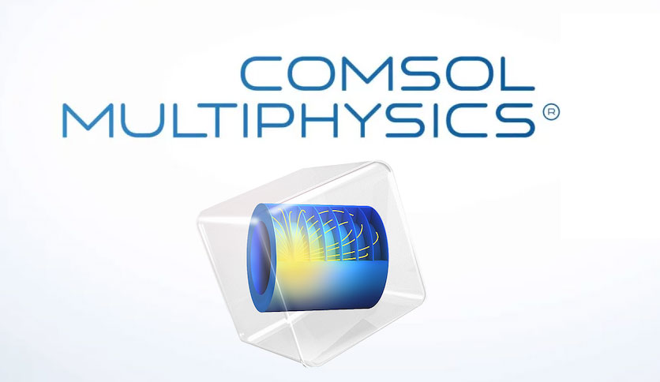    |

---

  <a href="https://github.com/ericaginevri/StepWise">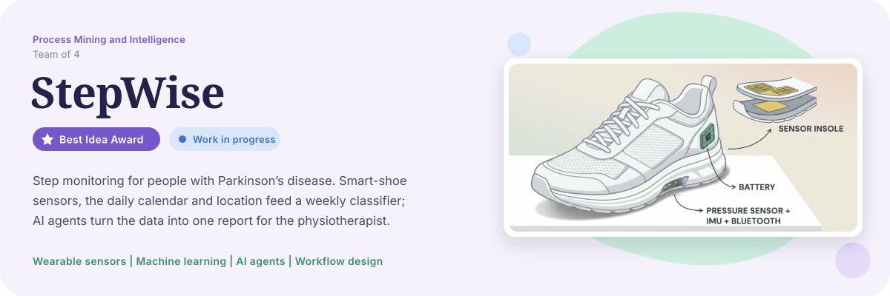</a>

  <a href="https://github.com/ericaginevri/EEGEmotionRecognition">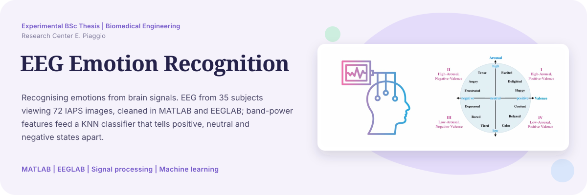</a>

  <a href="https://github.com/ericaginevri/Flaire"></a>
  <a href="https://github.com/ericaginevri/AmazonReviews">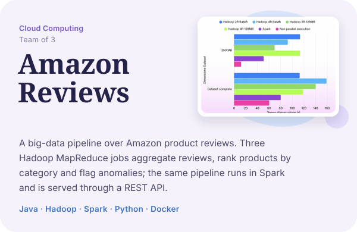</a>

  <a href="https://github.com/ericaginevri/HEMS"></a>
  <a href="https://github.com/ericaginevri/GeoRisk"></a>

<a href="https://www.linkedin.com/in/ericaginevri">
  
</a>
